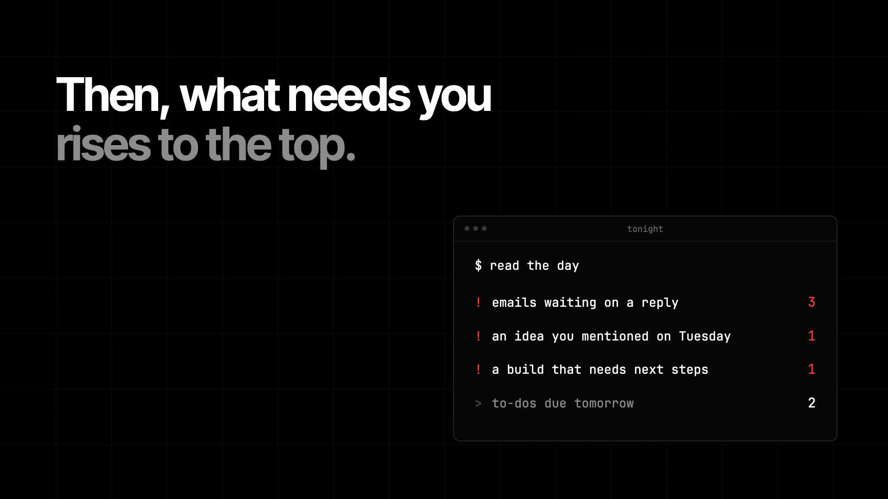
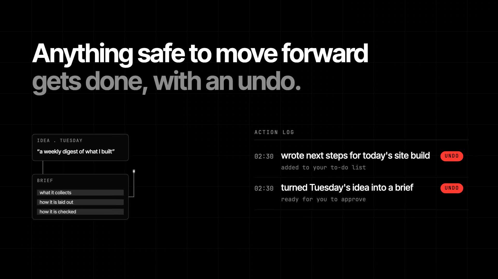
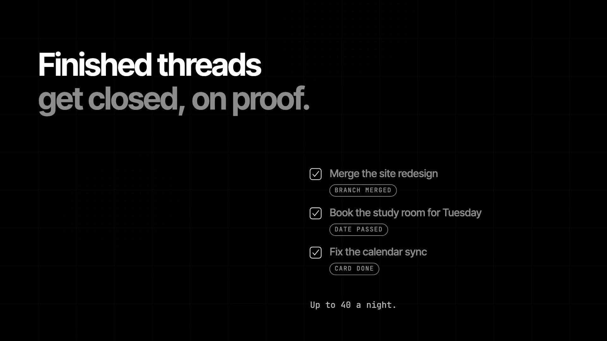
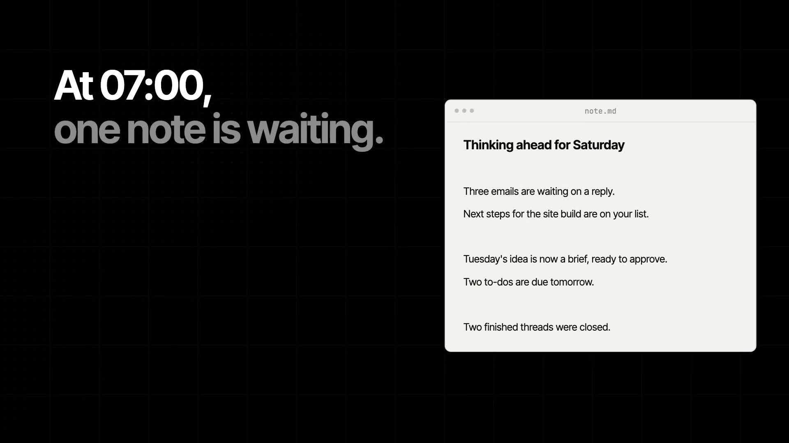

https://github.com/user-attachments/assets/e32e7fc3-2e8a-401b-90b7-edaa72fa1282

  

<h1 align="center">Chief of Staff</h1>

<strong>A night shift for everything you run.</strong>

  <a href="docs/media/chief-of-staff-v15.mp4">Watch the launch film</a> ·
  <a href="#the-night-shift">How it works</a> ·
  <a href="#build-on-the-public-components">Public components</a> ·
  <a href="docs/launch-assets.md">Media kit</a>

<strong>Go to sleep. Wake up sorted.</strong> Launch film v15 · 64.5 seconds · 1080p · sound on

Chief of Staff is the overnight coordination layer in my personal AI command centre. It reviews the system's recorded work, surfaces what needs attention, carries out a limited set of permitted maintenance actions, and leaves a thinking-ahead note for the morning.

**This repository is the public project showcase and launch media kit.** It contains the film, selected frames, the original system mark and an explanation of the design. The live Chief of Staff installation is part of my private command centre. A standalone installable Chief of Staff package is not included here.

## The night shift

### 01 / Read the day

The nightly pass reads job health, session handovers, the timed work queue, deadlines and the latest calendar-feed snapshot. The film's email and calendar labels represent information already captured into the command centre. They are not a claim that this repository connects to arbitrary inboxes or calendars.

### 02 / Raise what needs you

The thinking-ahead note puts unresolved work and useful next steps in one place. Work outside the permitted action list stays a recommendation. Decisions involving money, applications or other people remain with the owner.

### 03 / Keep safe work moving

The installed system can queue retries for failed jobs, propose a fix for repeated failures and refresh stale feed data. Each action is recorded before it happens. Reversible actions carry an undo command, with its limits made explicit. Cancelling a queued job, for example, only works before that job starts.

The film also illustrates the wider workflow around Chief of Staff: Follow-on turns completed work into candidate next steps, while Strategist produces the weekly review. These are separate cooperating systems.

### 04 / Close on evidence

The installation closes session threads when recorded evidence supports closure, with a cap on how many it handles per night. A merged branch or a completed task can provide that evidence. A past event may be archived as past, which is different from treating an expired deadline as completed.

### 05 / Leave one useful note

The nightly pass is configured for 02:30 in my installation, with the morning brief at 07:00. Those times are deployment choices, not hard requirements of the design. The result is a short note to read, rather than another dashboard to maintain.

### 06 / Look beyond tomorrow

On Sundays, the separate Strategist reviews the bigger picture: what is working, what deserves more time and what should be dropped. Candidate builds remain proposals until approved and queued.

## The operating principles

| Principle | What it means in the installed system |
| --- | --- |
| Evidence before closure | Work closes against a recorded reason, not a model's confidence alone. |
| Limited authority | Automation acts within a specific list of permitted operations. |
| Visible actions | An action log records what changed and why. |
| Honest undo | Reversible actions carry a command. Irreversible actions are identified as such. |
| Explicit coverage | A stale snapshot or an unavailable source is reported as a gap. |
| Human direction | Larger changes and consequential decisions come back to the owner. |

The systems begin in a dry-run state and require an explicit enable flag. The film is a designed explanation of the workflow, with simplified example counts and interface compositions. It is not a screen recording, a benchmark or a guarantee that every issue is resolved overnight.

## Build on the public components

The supporting pieces are published separately and have their own setup instructions and limitations.

| Project | Role |
| --- | --- |
| [Life Tracker Kit](https://github.com/cmills-dev/life-tracker-kit) | A starter for scheduled work, timed queues and session handovers. |
| [Steward](https://github.com/cmills-dev/steward) | Managed headless runs, checkpoints and resumption after usage limits. |
| [Polaris Desk](https://github.com/cmills-dev/polaris-desk) | A local dashboard for work, status and handback. |
| [Build Pipeline](https://github.com/cmills-dev/claude-build-pipeline) | Staged research, review, planning and build runs. |
| [Knowledge Bank](https://github.com/cmills-dev/lt-knowledge-bank) | Source-linked context for ongoing work. |
| [Dreaming](https://github.com/cmills-dev/dreaming) | A separate overnight pass over notes and connections. |

These components provide useful starting points. Cloning them does not recreate my private installation or automatically enable the Chief of Staff workflow.

## Launch assets

- [Watch or download the original v15 film](docs/media/chief-of-staff-v15.mp4).
- [Closing frame supplied for this launch](docs/media/closing-frame.png).
- [Original mark, SVG](docs/brand/chief-of-staff-mark.svg) and [square logo, PNG](docs/brand/chief-of-staff-logo.png).
- [Social preview, 1280 × 640](docs/brand/social-preview.png).
- [Frame timings, transcript and asset notes](docs/launch-assets.md).

The video at the top uses GitHub's native inline player. Press play to watch it here, or use the original MP4 link to download the full export.

---

Built by [Cameron Mills](https://thecameronmills.com). Practical AI systems, tools and automation.

© 2026 Cameron Mills. Launch media and branding are published for viewing. No reuse licence is granted by this showcase. Related code repositories have their own licences.
